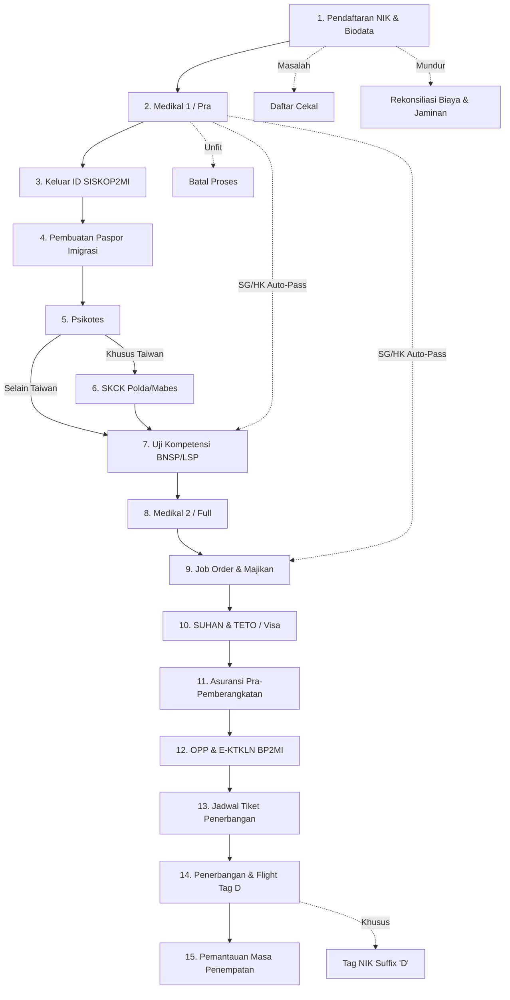

# af_symotech — AGENTS.md

**Proyek:** ERP & Sistem Penempatan Pekerja Migran Indonesia (P3MI / TKI) untuk PT Arni Family
**URL Live:** https://af.symotech.id
**Stack:** PHP 8.2 native + MySQL 8.0 (prosedural, tanpa framework, PDO & mysqli)

---

## Profil & Domain Bisnis

PT Arni Family adalah perusahaan penempatan pekerja migran (P3MI/TKI) ke negara tujuan seperti **Taiwan, Hong Kong, Singapura, Malaysia**, dan negara lainnya.
Sistem ini menangani seluruh siklus hidup proses pekerja migran mulai dari pendaftaran data diri, pemeriksaan medis, penerbitan dokumen resmi pemerintah (SISKOP2MI & Imigrasi), pencocokan majikan, visa kerja, orientasi, hingga penerbangan ke luar negeri dan pemantauan keuangan per pekerja.

---

## Alur Lengkap Proses Bisnis (Pipeline TKI / PMI)
*Panduan detail lengkap, SOP dokumen, dan kamus data tersedia di [ALUR_PROSES_BISNIS.md](file:///c:/Users/X1%20CARBON/Downloads/af_symotech/ALUR_PROSES_BISNIS.md).*

Setiap pekerja migran (`pendaftaran`) melewati 15 tahapan operasional dan dokumen secara berurutan:



### 1. Pendaftaran Calon Pekerja Migran (`pendaftaran.php`)
- **Aktivitas:** Registrasi data diri calon PMI: NIK (16 digit), nama, tempat/tgl lahir, jenis kelamin, agama, alamat lengkap, status perkawinan, cabang pendaftaran (`location`), sponsor/PL (`sponsor`), dan negara tujuan (`negara`).
- **Validasi Ketat NIK 16 Digit (AJAX real-time):**
  1. *Prioritas 1 (Cekal/Blacklist):* Cek ke tabel `masalah`. Jika NIK pernah bermasalah, input langsung diblokir dan dialihkan ke `detailmasalah.php`.
  2. *Prioritas 2 (Duplikasi Aktif):* Cek tabel `pendaftaran` dengan `status = 'aktive'`. Jika sudah terdaftar di cabang tertentu, sistem menolak duplikasi pendaftaran.
  3. *Prioritas 3 (Reaktivasi Eks-PMI):* Cek tabel `pendaftaran` dengan `status = 'nonaktive'`. Jika NIK pernah terdaftar dan sudah purna kontrak/batal, sistem mengarahkan ke `copypendaftaran.php` untuk pendaftaran periode baru tanpa mengetik ulang biodata dari nol.
- **Tabel Terkait:** `pendaftaran`, `location`, `sponsor`, `negara`.

---

### 2. Pemeriksaan Kesehatan 1 / Medical Pra (`belumkesehatan.php`, `kesehatan.php`)
- **Aktivitas:** Pemeriksaan kesehatan awal (tahap pra) di klinik/RS rekanan resmi untuk menyaring calon pekerja yang sehat jasmani dan rohani.
- **Antrean:** `belumkesehatan.php` menampilkan daftar pekerja berstatus `aktive` yang belum medikal (`tanggal_kesehatan IS NULL`).
- **Prasyarat Biaya:** Sebelum form `kesehatan.php` dapat diisi, biaya medikal (`kodeby = 1`) **harus sudah diinput** di tabel `nikby` dengan status `klaim = '0'`.
- **Hasil Medikal (`status_kes`):**
  - **`vit` (Fit):** Calon pekerja lolos dan siap lanjut ke tahap berikutnya.
  - **`unvit` (Unfit):** Pekerja gagal tes kesehatan; sistem **otomatis membatalkan** status pendaftaran (`UPDATE pendaftaran SET status = 'batal'`).
  - **`pending`:** Hasil laboratorium perlu pengobatan/tindak lanjut; masuk antrean khusus Pending.
- **Aturan Khusus Singapura & Hong Kong (Auto-Pass):**
  - Jika negara tujuan adalah **Singapura** atau **Hong Kong** dan hasil medikal dinyatakan **Fit (`vit`)**, sistem secara otomatis membuatkan data:
    1. `dapat_job` (Jabatan: `HOUSEMAID / CAREGIVER`, Mitra: `DIRECT HIRING`, mengupdate `tanggal_saat_job`).
    2. `ujikom` (Otomatis lulus sertifikasi kompetensi, mengupdate `tanggal_ujikom`).
- **Pencatatan Keuangan Otomatis:**
  - Status biaya di `nikby` diubah menjadi `klaim = '1'`.
  - Otomatis mencatat jurnal akuntansi: Debet COA Biaya Kesehatan (`61001`), Kredit COA Kas/Bank.

---

### 3. Penerbitan ID SISKOP2MI (`keluarid.php`, `keluaridin.php`)
- **Aktivitas:** Pendaftaran nomor registrasi resmi pekerja migran ke sistem SISKOP2MI milik Kementerian Ketenagakerjaan / BP2MI.
- **Input:** Nomor ID SISKOP2MI, tanggal terbit (`tanggal_keluar_id`), dan upload dokumen penetapan ID.
- **Tabel Terkait:** `keluar_id`, `pendaftaran`.

---

### 4. Pembuatan Rekomendasi & Paspor Imigrasi (`pasport.php`, `pasportin.php`)
- **Aktivitas:** Penerbitan surat rekomendasi paspor dari dinas tenaga kerja dan pengurusan buku paspor di Kantor Imigrasi.
- **Input:** Nomor Paspor, Kantor Imigrasi penerbit, tanggal berlaku, tanggal kedaluwarsa, upload scan paspor, update `tanggal_pembuatan_pasport`.
- **Tabel Terkait:** `pembuatan_paspor`, `pendaftaran`.

---

### 5. Psikotes (`sikotes.php`, `input_sikotes.php`)
- **Aktivitas:** Uji psikologi dan kesiapan mental pekerja untuk bekerja mandiri di luar negeri.
- **Input:** Lembaga psikotes, nomor sertifikat, tanggal psikotes, hasil evaluasi, update `tanggal_sikotes`.
- **Tabel Terkait:** `sikotes`, `pendaftaran`.

---

### 6. SKCK Khusus Taiwan (`skck.php`, `skck_input.php`)
- **Aktivitas:** Surat Keterangan Catatan Kepolisian (Polda/Mabes) khusus calon pekerja dengan tujuan **Taiwan** setelah menyelesaikan psikotes (`p.status = 'aktive' AND p.tanggal_sikotes IS NOT NULL AND p.negara = 'TAIWAN'`).
- **Input:** Lembaga kepolisian penerbit, nomor SKCK, tanggal terbit, masa berlaku, upload dokumen SKCK, update `tanggal_skck`.
- **Tabel Terkait:** `skck`, `pendaftaran`.

---

### 7. Uji Kompetensi BNSP / LSP (`ujikom.php`, `input_ujikom.php`)
- **Aktivitas:** Uji kompetensi kerja melalui Lembaga Sertifikasi Profesi (LSP) berlisensi BNSP sesuai profesi yang dituju (misal: Caregiver, Housemaid, Operator Pabrik, Konstruksi).
- **Input:** Nama LSP, skema uji kompetensi, nomor sertifikat BNSP, masa berlaku, update `tanggal_ujikom`.
- **Tabel Terkait:** `ujikom`, `pendaftaran`.

---

### 8. Pemeriksaan Kesehatan 2 / Medical Full (`belumkesehatan2.php`, `kesehatan2.php`)
- **Aktivitas:** Pemeriksaan kesehatan menyeluruh (rontgen paru-paru, tes darah, HIV/AIDS, hepatitis, tes kehamilan) yang diwajibkan oleh kedutaan besar sebelum penerbitan visa kerja.
- **Prasyarat Biaya:** Memeriksa entri biaya medikal 2 (`kodeby = 2`) di tabel `nikby`.
- **Update:** `tanggal_kesehatan2` di tabel `pendaftaran`.

---

### 9. Job Order & Matching Majikan (`belumjob.php`, `dapatjob.php`, `saatjob.php`)
- **Aktivitas:** Pencocokan calon pekerja dengan majikan/employer atau pabrik di negara penempatan melalui agensi mitra luar negeri.
- **Input:** Nama Majikan, Nama Agensi Mitra Asing, Alamat Tempat Kerja, Jabatan/Sektor Pekerjaan, Nilai Kontrak Gaji, Upload Perjanjian Kerja (PK), update `tanggal_saat_job`.
- **Tabel Terkait:** `dapat_job`, `saat_job`, `pendaftaran`.

---

### 10. SUHAN & TETO (Khusus Taiwan) atau Visa Kerja (`suhan.php`, `teto.php`, `visa.php`)
- **Khusus Taiwan:**
  1. **SUHAN (`suhan.php`, `suhanin.php`):** Pengurusan Surat Izin Perekrutan Tenaga Kerja Asing resmi dari Kemnaker Taiwan (*Ministry of Labor Taiwan*). Mencatat nomor SUHAN, tgl terbit, dan update `tanggal_suhan`.
  2. **TETO (`teto.php`, `tetoin.php`):** Pengajuan visa kerja ke kantor perwakilan diplomatik Taiwan di Indonesia (*Taipei Economic and Trade Office*). Mencatat nomor visa kerja TETO, update `tanggal_teto`.
- **Negara Lain (`visa.php`, `visainput.php`):** Pengurusan Calling Visa (Malaysia), In-Principle Approval / IPA (Singapura), atau Visa Kerja Hong Kong.
- **Tabel Terkait:** `suhan`, `teto`, `visa`, `pendaftaran`.

---

### 11. Asuransi Pra-Pemberangkatan (`asuransipra.php`, `input_asuransipra.php`)
- **Aktivitas:** Pembelian polis asuransi perlindungan tenaga kerja migran untuk masa sebelum keberangkatan (asuransi risiko gagal berangkat, sakit, dll.).
- **Input:** Perusahaan asuransi konsorsium, nomor polis, tanggal mulai & berakhir, upload polis, update `tanggal_asuransipra`.
- **Tabel Terkait:** `asuransipra`, `pendaftaran`.

---

### 12. Orientasi Pra-Pemberangkatan / E-KTKLN (`opp.php`, `oppin.php`)
- **Aktivitas:** Pelaksanaan Orientasi Pra-Pemberangkatan (OPP) oleh BP2MI dan penerbitan Elektronik Kartu Tenaga Kerja Luar Negeri (E-KTKLN) sebagai syarat mutlak lolos imigrasi bandara.
- **Input:** Nomor E-KTKLN / Kartu PMI, tanggal pelaksanaan OPP, update `tanggal_opp`.
- **Tabel Terkait:** `opp`, `pendaftaran`.

---

### 13. Jadwal Tiket & Penerbangan (`penerbangan.php`, `penerbanganinput.php`)
- **Aktivitas:** Pemesanan tiket pesawat internasional dan penentuan jadwal pelepasan bandara setelah visa selesai (`tglvisa > 0`).
- **Input:** Maskapai, kode booking tiket, nomor penerbangan, jam & tanggal terbang, update `tglterbang`.
- **Tabel Terkait:** `penerbangan`, `pendaftaran`.

---

### 14. Keberangkatan & Operasi Tag Suffix 'D' (`sudahterbang.php`, `sudahterbanginput.php`)
- **Aktivitas:** Pelepasan keberangkatan di bandara internasional setelah melewati imigrasi bandara.
- **Operasi Kritis Sistem saat Terbang (`sudahterbanginput.php`):**
  1. Mengupdate `tanggal_setelah_penempatan` di `pendaftaran`.
  2. **Propagasi Tag Suffix 'D':** NIK pekerja di **SELURUH tabel database** yang memiliki kolom `nik` otomatis diubah dari `$nik` menjadi **`$nik . 'D'`** (misal: `330101...` menjadi `330101...D` / *Departed*).
  3. Status pendaftaran diubah menjadi `status = 'nonaktive'`.
  4. NIK berakhiran `'D'` ini berfungsi menandakan pekerja sudah terbang, mencegah duplikasi proses aktif, dan menjadi arsip historis yang dapat di-copy jika pekerja mendaftar kembali di masa mendatang via `copypendaftaran.php`.

---

### 15. Pemantauan Masa Penempatan / Kontrak (`setelahpenempatan.php`, `setelahpenempatanin.php`)
- **Aktivitas:** Pemantauan kondisi pekerja migran selama masa kontrak kerja aktif di luar negeri (2 hingga 3 tahun), pencatatan Jaminan Sosial Ketenagakerjaan Luar Negeri (`provider_jamsos_A`, `no_jamsos_A`), serta pemantauan komunikasi pekerja, majikan, dan agensi perwakilan di negara tujuan.

---

### 14. Penanganan Kasus Khusus & Dokumen Fisik

- **TKI Mengundurkan Diri (`mundur.php`, `inputmundur.php`):**
  - Untuk pekerja yang membatalkan proses sebelum terbang (misal: hamil, sakit menahun, dilarang keluarga).
  - Sistem mencatat tanggal mundur, alasan pembatalan, rekonsiliasi ganti rugi biaya proses yang sudah dikeluarkan, serta pengembalian berkas fisik.
- **TKI Bermasalah (`masalah.php`, `inputmasalah.php`):**
  - Untuk pekerja yang mengalami masalah hukum, kabur dari majikan (*runaway*), kekerasan, atau dideportasi.
  - Data NIK otomatis masuk ke daftar cekal/blacklist prioritas 1 pada form pendaftaran baru.
- **Penitipan Berkas Jaminan Asli (`jaminan.php`, `jaminanin.php`, `jaminanout.php`):**
  - Pengelolaan berkas asli milik pekerja yang dititipkan sebagai jaminan proses (Ijazah Asli, Akta Kelahiran, Buku Nikah Asli, KTP/KK Asli).
  - Tanda terima penyerahan berkas (`jaminanprint.php`) dan serah terima pengembalian berkas saat selesai kontrak/batal (`jaminanout.php`).

---

## Modul Keuangan & Akuntansi Biaya TKI

1. **Laporan Biaya Per TKI (`biayapertki.php`):**
   - Buku besar biaya proses per individu pekerja.
   - Tabel `nikby` mencatat setiap biaya yang dikeluarkan (nominal `nom`, tanggal, kode biaya `kodeby` berelasi ke `jenisbiaya`).
   - Tracking status klaim: `klaim = '0'` (belum diklaim / *outstanding*), `klaim = '1'` (sudah diklaim / diakui).
   - Dilengkapi filter status klaim, rentang tanggal, filter cabang, dan pencarian NIK/nama.
2. **Kas & Bank Khusus TKI (`kastki.php`, `banktki.php`):**
   - Input penerimaan dan pengeluaran kas/bank yang langsung dialokasikan ke NIK pekerja tertentu.
   - Otomatis mencatat mutasi jurnal akuntansi umum.
3. **Fee / Komisi Sponsor (`feesponsor.php`, `sponsorin.php`, `fee.php`):**
   - Manajemen mitra lapangan / Petugas Lapangan (PL) yang merekrut calon TKI.
   - Perhitungan tarif komisi sponsor berdasarkan master tarif per negara tujuan (`tariffee`).
4. **Akuntansi Umum:** Master COA (`coa.php`), Jurnal (`jurnal.php`), Buku Besar (`ledger.php`), Neraca Saldo (`ns2.php`), Laba Rugi (`lr.php`, `lr2.php`), dan Tutup Buku Periode (`closing.php`).

*Daftar audit lengkap, backlog prioritas, dan catatan perbaikan modul akuntansi tersedia di [CATATAN_AUDIT_AKUNTANSI_DAN_BACKLOG.md](CATATAN_AUDIT_AKUNTANSI_DAN_BACKLOG.md).*

---

## Sistem Approval Izin Edit Data (Anti-Fraud Cabang)

Untuk mencegah manipulasi data sepihak oleh kantor cabang:
1. Seluruh data proses yang sudah disimpan akan otomatis terkunci (`edit = 'clouse'`).
2. Jika cabang ingin memperbaiki data, cabang wajib mengajukan permintaan edit melalui menu `reqedit_*.php` dengan mengisi alasan perbaikan (`minta = 1`).
3. Kantor Pusat (HO / Admin Pusat) memverifikasi permintaan di menu `izinedit.php`.
4. Jika disetujui HO (`proses_izinedit.php`), flag diubah menjadi `edit = 'open'`.
5. Cabang dapat membuka form edit (`edit_*.php`), dan setelah disimpan flag otomatis dikembalikan terkunci (`edit = 'clouse'`, `minta = 0`).

Tabel yang dilindungi sistem izin edit:
`pendaftaran`, `kesehatan`, `kesehatan2`, `sikotes`, `dapat_job`, `ujikom`, `keluar_id`, `skck`, `asuransipra`, `pembuatan_paspor`, `visa`, `penerbangan`.

---

## Aturan Deployment & CI/CD (KRITIS)

- **Push ke branch `main`:** Otomatis mentrigger GitHub Actions (`.github/workflows/deploy.yml`) yang memanggil webhook ke `https://af.symotech.id/gitpull.php`.
- **Pemeriksaan Sintaks Wajib Lolos:** GitHub Actions menjalankan:
  ```bash
  find . -name "*.php" -print0 | xargs -0 -n1 php -l || exit 1
  ```
  **Setiap file PHP yang dimodifikasi WAJIB lulus `php -l` tanpa syntax error.** Satu error saja akan menggagalkan deploy ke cPanel.
