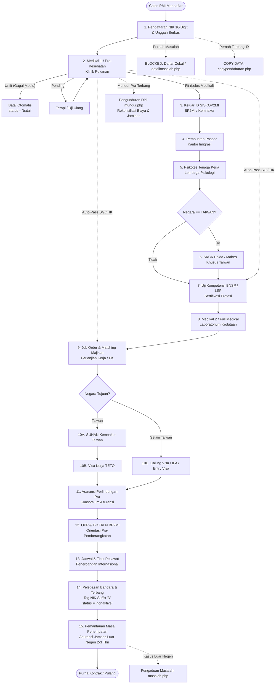
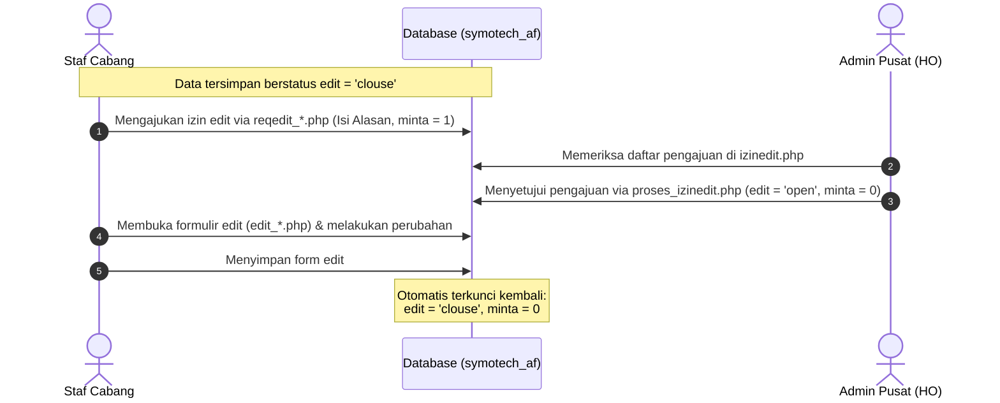

# DOKUMENTASI LENGKAP ALUR PROSES BISNIS & ARSITEKTUR SISTEM
## PT ARNI FAMILY (P3MI / TKI ERP SYSTEM)
**Sistem Informasi Manajemen Penempatan Pekerja Migran Indonesia**
**URL Produksi:** [https://af.symotech.id](https://af.symotech.id)
**Tech Stack:** PHP 8.2 Native (Procedural, PDO & MySQLi) + MySQL 8.0

---

## DAFTAR ISI
1. [Profil Perusahaan & Arsitektur Bisnis](#1-profil-perusahaan--arsitektur-bisnis)
2. [Diagram Alur Pipeline Operasional (15 Tahap)](#2-diagram-alur-pipeline-operasional-15-tahap)
3. [Rincian Setiap Tahapan Operasional Pekerja Migran](#3-rincian-setiap-tahapan-operasional-pekerja-migran)
   - [Tahap 1: Pendaftaran Calon Pekerja Migran](#tahap-1-pendaftaran-calon-pekerja-migran-pendaftaranphp)
   - [Tahap 2: Medikal 1 / Pra-Kesehatan](#tahap-2-medikal-1--pra-kesehatan-belumkesehatanphp-kesehatanphp)
   - [Tahap 3: Penerbitan ID SISKOP2MI](#tahap-3-penerbitan-id-siskop2mi-keluaridphp-keluaridinphp)
   - [Tahap 4: Pembuatan Rekomendasi & Paspor Imigrasi](#tahap-4-pembuatan-rekomendasi--paspor-imigrasi-pasportphp-pasportinphp)
   - [Tahap 5: Psikotes Tenaga Kerja](#tahap-5-psikotes-tenaga-kerja-sikotesphp-input_sikotesphp)
   - [Tahap 6: SKCK Khusus Taiwan](#tahap-6-skck-khusus-taiwan-skckphp-skck_inputphp)
   - [Tahap 7: Uji Kompetensi BNSP / LSP](#tahap-7-uji-kompetensi-bnsp--lsp-ujikomphp-input_ujikomphp)
   - [Tahap 8: Medikal 2 / Full-Medical](#tahap-8-medikal-2--full-medical-belumkesehatan2php-kesehatan2php)
   - [Tahap 9: Job Order & Pencocokan Majikan](#tahap-9-job-order--pencocokan-majikan-belumjobphp-dapatjobphp-saatjobphp)
   - [Tahap 10: SUHAN & TETO (Taiwan) atau Visa Kerja](#tahap-10-suhan--teto-taiwan-atau-visa-kerja-suhanphp-tetophp-visaphp)
   - [Tahap 11: Asuransi Pra-Pemberangkatan](#tahap-11-asuransi-pra-pemberangkatan-asuransipraphp-input_asuransipraphp)
   - [Tahap 12: OPP & E-KTKLN BP2MI](#tahap-12-opp--e-ktkln-bp2mi-oppphp-oppinphp)
   - [Tahap 13: Jadwal Tiket & Penerbangan](#tahap-13-jadwal-tiket--penerbangan-penerbanganphp-penerbanganinputphp)
   - [Tahap 14: Keberangkatan & Operasi Tag Suffix 'D'](#tahap-14-keberangkatan--operasi-tag-suffix-d-sudahterbangphp-sudahterbanginputphp)
   - [Tahap 15: Pemantauan Kontrak Setelah Penempatan](#tahap-15-pemantauan-kontrak-setelah-penempatan-setelahpenempatanphp-setelahpenempataninphp)
4. [Penanganan Kasus Khusus & Pengelolaan Berkas Fisik](#4-penanganan-kasus-khusus--pengelolaan-berkas-fisik)
   - [TKI Mengundurkan Diri / Batal Proses](#41-tki-mengundurkan-diri--batal-proses-mundurphp)
   - [TKI Bermasalah di Luar Negeri (Blacklist)](#42-tki-bermasalah-di-luar-negeri-blacklist-masalahphp)
   - [Penitipan & Serah Terima Berkas Jaminan Asli](#43-penitipan--serah-terima-berkas-jaminan-asli-jaminanphp)
5. [Alur Keuangan, Kas TKI & Akuntansi Biaya Per NIK](#5-alur-keuangan-kas-tki--akuntansi-biaya-per-nik)
   - [Master Jenis Biaya & Pemetaan COA](#51-master-jenis-biaya--pemetaan-coa-jenisbiayaphp)
   - [Buku Besar Biaya Per TKI](#52-buku-besar-biaya-per-tki-biayapertkiphp)
   - [Kas TKI & Bank TKI (Pecah Nominal Multi-NIK)](#53-kas-tki--bank-tki-pecah-nominal-multi-nik-kastkiphp-banktkiphp)
   - [Komisi / Fee Sponsor Lapangan](#54-komisi--fee-sponsor-lapangan-sponsorinphp-feephp)
   - [Modul Akuntansi Umum ERP](#55-modul-akuntansi-umum-erp)
6. [Sistem Approval Izin Edit Data (Anti-Fraud Cabang)](#6-sistem-approval-izin-edit-data-anti-fraud-cabang)
7. [Struktur Hak Akses & Dual-Cabang (HO vs Cabang)](#7-struktur-hak-akses--dual-cabang-ho-vs-cabang)
8. [Kamus Data Tabel-Tabel Kunci Database](#8-kamus-data-tabel-tabel-kunci-database)
9. [Prosedur CI/CD, Deployment & Standar Kode](#9-prosedur-cicd-deployment--standar-kode)

---

## 1. Profil Perusahaan & Arsitektur Bisnis

**PT Arni Family** adalah Perusahaan Penempatan Pekerja Migran Indonesia (P3MI) resmi yang beroperasi di bawah regulasi Kementerian Ketenagakerjaan (Kemnaker RI) dan Badan Pelindungan Pekerja Migran Indonesia (BP2MI).

### Sektor dan Negara Penempatan
1. **Taiwan:** Sektor Formal (Pabrik Manufaktur, Konstruksi, Nelayan) dan Sektor Informal (Caregiver Rumah Tangga, Nursing Home). Memerlukan tahapan khusus: SKCK Polda/Mabes, penerbitan SUHAN (Izin Rekrut), dan pengurusan Visa Kerja TETO.
2. **Hong Kong:** Sektor Domestik (Housemaid, Caregiver). Mendukung sistem *Direct Hiring* dengan fitur otomatisasi (*Auto-Pass*) saat Medikal 1 Fit.
3. **Singapura:** Sektor Domestik (Housemaid). Mendukung sistem *Direct Hiring* dengan fitur otomatisasi (*Auto-Pass*) saat Medikal 1 Fit.
4. **Malaysia:** Sektor Formal (Perkebunan, Pabrik) dan Informal via *Calling Visa*.
5. **Negara Lainnya:** Menyesuaikan regulasi imigrasi dan ketenagakerjaan setempat.

### Struktur Operasional Sistem (Dual-Level User)
- **Kantor Pusat (Head Office / HO - `location = 1`):** Memegang kontrol penuh terhadap verifikasi data, approval izin edit data dari cabang, akuntansi terpusat, pengurusan visa/SUHAN/TETO di kedutaan/kementerian, dan pelepasan keberangkatan bandara.
- **Kantor Cabang Daerah (`location > 1`):** Bertanggung jawab atas perekrutan di daerah, verifikasi berkas awal calon PMI, pendampingan medikal pra di klinik rekanan lokal, pembuatan paspor di kantor imigrasi daerah, dan penitipan jaminan berkas asli. Seluruh data cabang diisolasi secara ketat berdasarkan `me.location`.

---

## 2. Diagram Alur Pipeline Operasional (15 Tahap)



---

## 3. Rincian Setiap Tahapan Operasional Pekerja Migran

### Tahap 1: Pendaftaran Calon Pekerja Migran (`pendaftaran.php`)
- **Tujuan:** Registrasi identitas resmi calon PMI ke dalam database perusahaan.
- **Form Input Data:**
  - Data Pribadi: NIK (16 digit), Nama lengkap, Nama panggilan/Alias (`namas`), Tempat & Tanggal Lahir, Jenis Kelamin, Agama, Pendidikan Terakhir, Alamat KTP, Kode Pos, Kelurahan, Kecamatan, Kabupaten, No. Telepon/WA, Alamat Email.
  - Berkas Unggahan: Foto Diri berwarna (`ft`), Scan KTP (`ktp`), Scan Kartu Keluarga (`kk`), Scan Surat Nikah / Akta Cerai (`ftp` jika status nikah bukan lajang).
  - Data Keluarga & Ahli Waris: Nama Ayah, Nama Ibu, Alamat Orang Tua, Telp Orang Tua, Nama Ahli Waris, Hubungan Keluarga, Alamat Ahli Waris, Telp Ahli Waris, Email Ahli Waris.
  - Data Perekrutan: Kantor Cabang pendaftaran (`cabang`), Sponsor/PL Lapangan (`sponsor`), Negara Tujuan (`negara`), Tanggal Pendaftaran.
- **Validasi Realtime NIK 16-Digit (AJAX Multi-Level):**
  1. **Level 1 (Prioritas Tertinggi - Cekal/Blacklist):** Sistem memeriksa tabel `masalah` (`LEFT(nik, 16) = ?`). Jika NIK pernah memiliki catatan kasus atau masuk blacklist, pendaftaran langsung **DIBLOKIR TOTAL** dan layar dialihkan ke `detailmasalah.php`.
  2. **Level 2 (Pencegahan Duplikasi Aktif):** Sistem memeriksa tabel `pendaftaran` dengan `status = 'aktive'`. Jika NIK sudah terdaftar aktif, pendaftaran ditolak dengan notifikasi: *"NIK sudah terdaftar di [Nama Cabang] dengan sponsor [Nama Sponsor]"*.
  3. **Level 3 (Reaktivasi Eks-PMI):** Sistem memeriksa tabel `pendaftaran` dengan `status = 'nonaktive'` (pekerja yang pernah terbang dan NIK-nya berakhiran 'D' atau purna kontrak). Sistem otomatis mengarahkan ke `copypendaftaran.php?nik={nik}` sehingga admin cabang tidak perlu mengetik ulang biodata lama, melainkan cukup mengonfirmasi dan memperbarui data yang berubah untuk periode keberangkatan baru.
- **Keamanan:** Status izin edit diset `edit = 'clouse'`.

---

### Tahap 2: Medikal 1 / Pra-Kesehatan (`belumkesehatan.php`, `kesehatan.php`)
- **Tujuan:** Pemeriksaan kesehatan dasar calon PMI untuk memastikan fisik dan organ vital memenuhi standar sebelum modal biaya proses dikeluarkan.
- **Antrean:** `belumkesehatan.php` menampilkan antrean PMI dengan status `aktive` yang belum memiliki tanggal medikal 1 (`tanggal_kesehatan IS NULL`).
- **Prasyarat Biaya (Pre-condition):** Sebelum dokter/admin dapat menyimpan form medikal di `kesehatan.php`, sistem memverifikasi bahwa entri biaya pemeriksaan medikal (`kodeby = 1`) **sudah tercatat** di tabel `nikby` untuk NIK tersebut dengan status `klaim = '0'`.
- **Hasil Pemeriksaan (`status_kes`):**
  - **`vit` (Fit):** Calon PMI dinyatakan sehat dan lolos ke tahap berikutnya.
  - **`unvit` (Unfit):** Calon PMI gagal medis. Sistem **secara otomatis membatalkan** registrasi pekerja (`UPDATE pendaftaran SET status = 'batal' WHERE nik = ?`).
  - **`pending`:** Hasil lab memerlukan pengobatan singkat atau tes ulang; ditempatkan di daftar tunggu.
- **Otomatisasi Khusus Singapura & Hong Kong (Auto-Pass):**
  - Mengingat pasar Singapura dan Hong Kong didominasi sistem *Direct Hiring*, jika negara tujuan adalah **`SINGAPURA`** atau **`HONG KONG`** dan hasil medikal **`vit`**, sistem secara otomatis:
    1. Membuat baris data di tabel `dapat_job`: Jabatan diset `HOUSEMAID / CAREGIVER`, Mitra diset `DIRECT HIRING`, dan otomatis mengupdate kolom `tanggal_saat_job` di tabel `pendaftaran`.
    2. Membuat baris data di tabel `ujikom`: Mengesahkan kompetensi dasar dan otomatis mengupdate kolom `tanggal_ujikom` di tabel `pendaftaran`.
- **Dampak Keuangan:**
  - Status klaim di `nikby` diubah dari `'0'` menjadi `'1'`.
  - Sistem otomatis membuat ayat jurnal: Debet Biaya Medikal Pra (`61001`), Kredit Kas/Bank.

---

### Tahap 3: Penerbitan ID SISKOP2MI (`keluarid.php`, `keluaridin.php`)
- **Tujuan:** Mendaftarkan calon PMI ke dalam Sistem Informasi dan Komputerisasi Pelayanan Penempatan dan Perlindungan Pekerja Migran Indonesia (SISKOP2MI).
- **Proses:**
  - Calon PMI yang lolos Medikal 1 diajukan ke dinas tenaga kerja / BP2MI untuk memperoleh Nomor Registrasi ID resmi.
  - Input: Nomor ID SISKOP2MI (`Id_tki`), upload scan bukti penetapan ID (`upload_idtki`), tanggal penetapan ID.
  - Update sistem: Kolom `tanggal_keluar_id` pada tabel `pendaftaran` terisi tanggal penetapan.
- **Tabel:** `keluar_id`, `pendaftaran`.

---

### Tahap 4: Pembuatan Rekomendasi & Paspor Imigrasi (`pasport.php`, `pasportin.php`)
- **Tujuan:** Pengurusan surat rekomendasi paspor dari Disnaker dan pencetakan buku paspor di Kantor Imigrasi.
- **Proses:**
  - Calon PMI didampingi petugas cabang datang ke Kantor Imigrasi untuk foto biometrik dan wawancara.
  - Input: Nama lengkap sesuai paspor, Nomor Paspor, Kantor Imigrasi Penerbit, Tanggal Terbit, Tanggal Habis Berlaku, upload scan halaman depan dan visa paspor.
  - Update sistem: Kolom `tanggal_pembuatan_pasport` pada tabel `pendaftaran` terisi tanggal paspor.
- **Tabel:** `pembuatan_paspor`, `pendaftaran`.

---

### Tahap 5: Psikotes Tenaga Kerja (`sikotes.php`, `input_sikotes.php`)
- **Tujuan:** Uji evaluasi kepribadian, stabilitas emosi, ketahanan kerja di bawah tekanan, dan kesiapan mental berpisah dengan keluarga.
- **Proses:**
  - Dilakukan oleh biro/psikolog rekanan berlisensi HIMPSI.
  - Input: Nama Lembaga Penguji (`provider_siko`), Nomor Sertifikat Hasil Uji, Tanggal Uji, Tanggal Akhir Masa Berlaku, Status Hasil (`status_siko`: Lulus / Tidak Lulus / Rekomendasi Bersyarat), upload scan sertifikat psikotes.
  - Update sistem: Kolom `tanggal_sikotes` pada tabel `pendaftaran` terisi tanggal psikotes.
- **Tabel:** `sikotes`, `pendaftaran`.

---

### Tahap 6: SKCK Khusus Taiwan (`skck.php`, `skck_input.php`)
- **Tujuan:** Memenuhi syarat mutlak dari Ministry of Foreign Affairs (MOFA) Taiwan / TETO berupa catatan bebas tindak kriminal dari Kepolisian Negara Republik Indonesia.
- **Filter Sistem:** Hanya aktif untuk calon PMI dengan negara tujuan **`TAIWAN`** yang telah menyelesaikan tahap psikotes (`status = 'aktive' AND tanggal_sikotes IS NOT NULL AND negara = 'TAIWAN'`).
- **Proses:**
  - Pembuatan SKCK tingkat Polda / Mabes Polri yang kemudian dilegalisir oleh Kemenkumham dan Kemenlu.
  - Input: Lembaga Kepolisian Penerbit (`provider_skck`), Nomor SKCK, Tanggal Terbit, Tanggal Kadaluwarsa, upload scan berkas SKCK.
  - Update sistem: Kolom `tanggal_skck` pada tabel `pendaftaran` terisi tanggal SKCK.
- **Tabel:** `skck`, `pendaftaran`.

---

### Tahap 7: Uji Kompetensi BNSP / LSP (`ujikom.php`, `input_ujikom.php`)
- **Tujuan:** Menguji dan mengesahkan kecakapan teknis calon tenaga kerja melalui Lembaga Sertifikasi Profesi (LSP) berlisensi Badan Nasional Sertifikasi Profesi (BNSP).
- **Skema Profesi:**
  - Caregiver (Pengasuh Lansia / Orang Sakit)
  - Housemaid (Penata Laksana Rumah Tangga)
  - Operator Manufaktur / Pabrik
  - Pekerja Konstruksi
- **Proses:**
  - Calon PMI menjalani pelatihan di Balai Latihan Kerja Luar Negeri (BLKLN) lalu mengikuti asesmen uji kompetensi.
  - Input: Nama LSP (`provider_ujikom`), Nomor Sertifikat BNSP, Nomor Perjanjian Uji, Tanggal Terbit, Masa Berlaku, upload berkas sertifikat.
  - Update sistem: Kolom `tanggal_ujikom` pada tabel `pendaftaran` terisi.
- *(Catatan: Untuk negara tujuan Singapura & Hong Kong, tahap ini sudah terisi otomatis dari Auto-Pass Medikal 1).*

---

### Tahap 8: Medikal 2 / Full-Medical (`belumkesehatan2.php`, `kesehatan2.php`)
- **Tujuan:** Pemeriksaan kesehatan komprehensif (X-ray paru-paru bebas TBC, uji serologi sifilis, tes bebas HIV/AIDS, Hepatitis B/C, dan tes kehamilan) yang wajib masih berlaku saat pengajuan visa ke kedutaan asing.
- **Prasyarat Biaya:** Memeriksa entri biaya medikal 2 (`kodeby = 2`) di tabel `nikby`.
- **Input:** Nama RS/Laboratorium rekanan Kedutaan, Nomor Sertifikat Medikal, Tanggal Pemeriksaan, Tanggal Kadaluwarsa, Hasil Medikal (`vit`, `unvit`, `pending`), upload scan berkas medikal 2.
- **Update Sistem:** Kolom `tanggal_kesehatan2` di tabel `pendaftaran`.
- **Tabel:** `kesehatan2`, `pendaftaran`.

---

### Tahap 9: Job Order & Pencocokan Majikan (`belumjob.php`, `dapatjob.php`, `saatjob.php`)
- **Tujuan:** Memasangkan kandidat PMI dengan pemberi kerja / majikan (*Employer*) di luar negeri melalui agensi mitra resmi (*Foreign Employment Agency*).
- **Proses:**
  - Kandidat dipertemukan melalui wawancara video call (*online interview*) atau seleksi berkas biodata oleh calon majikan.
  - Input: Identitas Pengguna/Majikan (Nama, Alamat, Kota, Telepon, Email), Nama Agensi Mitra Luar Negeri, Nomor Job Order, Jabatan/Sektor Kerja, Durasi Kontrak Kerja, Gaji Pokok (NT$, HK$, RM, atau S$), serta upload dokumen Perjanjian Kerja (PK) yang ditandatangani kedua belah pihak.
  - Update sistem: Kolom `tanggal_saat_job` di tabel `pendaftaran`.
- *(Catatan: Untuk Singapura & Hong Kong, ter-auto-pass saat Medikal 1).*

---

### Tahap 10: SUHAN & TETO (Taiwan) atau Visa Kerja (`suhan.php`, `teto.php`, `visa.php`)
- **Tujuan:** Memperoleh izin kerja resmi dari pemerintah negara tujuan dan stempel visa kerja diplomatik.
- **Jalur Khusus Penempatan TAIWAN:**
  1. **SUHAN (`suhan.php`, `suhanin.php`):** Penerbitan Surat Izin Rekrut Resmi dari Kementerian Tenaga Kerja Taiwan (*Ministry of Labor*). Admin HO mencatat nomor dokumen SUHAN, tanggal penerbitan, upload berkas SUHAN, dan mengupdate kolom `tanggal_suhan` di `pendaftaran`.
  2. **TETO (`teto.php`, `tetoin.php`):** Pengajuan visa kerja ke kantor perwakilan diplomatik *Taipei Economic and Trade Office* di Jakarta atau Surabaya. Admin mencatat nomor visa kerja, tanggal terbit visa, upload scan stempel visa, dan mengupdate kolom `tanggal_teto` di `pendaftaran`.
- **Jalur Penempatan Negara Lain (`visa.php`, `visainput.php`):**
  - Mengurus *Calling Visa* untuk Malaysia, *In-Principle Approval (IPA)* untuk Singapura, atau *Employment Visa* untuk Hong Kong.
  - Input: Nomor Dokumen Visa, Tanggal Berlaku, Tanggal Berakhir, upload scan berkas visa.
  - Update sistem: Kolom `tglvisa` di tabel `pendaftaran`.

---

### Tahap 11: Asuransi Pra-Pemberangkatan (`asuransipra.php`, `input_asuransipra.php`)
- **Tujuan:** Memberikan jaminan perlindungan finansial bagi calon PMI dari konsorsium asuransi resmi pemerintah selama masa menunggu keberangkatan.
- **Manfaat Perlindungan:** Santunan kecelakaan saat di BLKLN, santunan sakit, atau ganti rugi jika terjadi kegagalan berangkat yang bukan disebabkan oleh kelalaian calon pekerja.
- **Input:** Nama Perusahaan Konsorsium Asuransi (`provider_asuransipra`), Nomor Polis Asuransi, Nomor Perjanjian, Tanggal Mulai, Tanggal Berakhir, upload berkas polis.
- **Update Sistem:** Kolom `tanggal_asuransipra` di tabel `pendaftaran`.
- **Tabel:** `asuransipra`, `pendaftaran`.

---

### Tahap 12: OPP & E-KTKLN BP2MI (`opp.php`, `oppin.php`)
- **Tujuan:** Pelaksanaan Orientasi Pra-Pemberangkatan (OPP) oleh BP2MI dan penerbitan tanda bukti legalitas fisik/digital tenaga kerja luar negeri.
- **Proses:**
  - Calon PMI menerima materi pembekalan terkait budaya, hukum ketenagakerjaan, penanganan darurat kekerasan/pelecehan, hak keuangan perbankan, dan kontak hotline KBRI/KDEI.
  - BP2MI menerbitkan Elektronik Kartu Tenaga Kerja Luar Negeri (E-KTKLN) / Kartu PMI.
  - Input: Nomor E-KTKLN / Kartu PMI (`nomor_kartu`), Nama Dokumen, Tanggal OPP, upload file bukti kartu.
  - Update sistem: Kolom `tanggal_opp` di tabel `pendaftaran`.
- **Tabel:** `opp`, `pendaftaran`.

---

### Tahap 13: Jadwal Tiket & Penerbangan (`penerbangan.php`, `penerbanganinput.php`)
- **Tujuan:** Pemesanan tiket pesawat internasional dan penentuan jadwal *flight departure*.
- **Syarat Antrean:** PMI berstatus aktif yang sudah memiliki visa resmi (`tglvisa > 0`) dan belum terjadwal terbang (`tglterbang IS NULL OR tglterbang = '0000-00-00'`).
- **Input:** Maskapai Penerbangan (misal: China Airlines, EVA Air, Cathay Pacific, Singapore Airlines, Malaysia Airlines), Nomor Penerbangan, Kode Booking (PNR), Nomor E-Ticket, Tanggal & Jam Keberangkatan, Bandara Asal (misal: CGK / SUB), Bandara Transit, Bandara Tujuan (TPE, KHH, HKG, SIN, KUL), upload tiket.
- **Update Sistem:** Kolom `tglterbang` di tabel `pendaftaran`.
- **Tabel:** `penerbangan`, `pendaftaran`.

---

### Tahap 14: Keberangkatan & Operasi Tag Suffix 'D' (`sudahterbang.php`, `sudahterbanginput.php`)
- **Tujuan:** Mengonfirmasi bahwa pekerja telah melewati pintu imigrasi bandara internasional dan resmi terbang meninggalkan Indonesia menuju negara penempatan.
- **Operasi Kritis Sistem (Atomic Multi-Table Propagation):**
  Saat form `sudahterbanginput.php` disubmit, sistem menjalankan transaksi database terpadu:
  ```php
  $conn->begin_transaction();
  
  $nik_lama = $nik;
  $nik_baru = $nik . 'D'; // Contoh: '3301012304950001' -> '3301012304950001D'
  
  // 1. Simpan tanggal setelah penempatan
  UPDATE pendaftaran SET tanggal_setelah_penempatan = ? WHERE nik = '$nik_lama';
  
  // 2. Loop dinamis ke SEMUA tabel yang memiliki kolom 'nik'
  $res = $conn->query("SHOW TABLES");
  while ($table = $res->fetch_array()[0]) {
      $hasCol = $conn->query("SELECT 1 FROM INFORMATION_SCHEMA.COLUMNS WHERE TABLE_SCHEMA = DATABASE() AND TABLE_NAME = '$table' AND COLUMN_NAME = 'nik'");
      if ($hasCol->num_rows > 0) {
          UPDATE `$table` SET nik = '$nik_baru' WHERE nik = '$nik_lama';
      }
  }
  
  // 3. Ubah status pendaftaran menjadi non-aktif
  UPDATE pendaftaran SET status = 'nonaktive' WHERE nik = '$nik_baru';
  
  $conn->commit();
  ```
- **Alasan Rekayasa Arsitektur Suffix 'D':**
  1. Mencegah PMI yang sudah berangkat muncul kembali di antrean operasional pra-pemberangkatan manapun.
  2. Mencegah terjadinya duplikasi pendaftaran di kantor cabang lain selama pekerja masih berada di luar negeri.
  3. Menjaga integritas data historis buku besar keuangan (`nikby`), jaminan berkas, dan dokumen resmi tanpa terhapus.
  4. Memungkinkan pendaftaran ulang secara instan (*one-click re-registration*) di kemudian hari melalui `copypendaftaran.php` saat pekerja kembali ke tanah air dan ingin berangkat lagi (karena NIK aslinya dapat dikenali dari `LEFT(nik, 16)`).

---

### Tahap 15: Pemantauan Kontrak Setelah Penempatan (`setelahpenempatan.php`, `setelahpenempatanin.php`)
- **Tujuan:** Pengawasan masa kerja aktif pekerja migran selama masa kontrak 2 sampai 3 tahun di luar negeri.
- **Pencatatan Asuransi Masa Penempatan:**
  - Mencatat data Jaminan Sosial Luar Negeri / Asuransi Masa Kerja (`provider_jamsos_A`, `no_jamsos_A`, `tgl_jamsos_A`, `tglend_jamsos_A`).
- **Aktivitas:**
  - Memastikan hak gaji pekerja dibayarkan tepat waktu sesuai kontrak PK.
  - Komunikasi antara kantor pusat PT Arni Family dengan agensi mitra di Taiwan/HK/Singapura/Malaysia.
  - Pendampingan apabila terjadi pergantian majikan (*transfer employer*) resmi atau repatriasi purna kontrak.

---

## 4. Penanganan Kasus Khusus & Pengelolaan Berkas Fisik

### 4.1. TKI Mengundurkan Diri / Batal Proses (`mundur.php`, `inputmundur.php`)
- **Penyebab:** Calon PMI memutuskan berhenti di tengah proses (misal: dilarang suami/keluarga, hamil saat proses berjalan, sakit menahun, atau kabur dari penampungan).
- **Prosedur:**
  1. Petugas menginput tanggal pengunduran diri dan alasan lengkap di `inputmundur.php`.
  2. Sistem memasukkan data ke tabel `mundur` dengan status `edit = 'open'`.
  3. Status di tabel `pendaftaran` otomatis diubah menjadi `status = 'nonaktive'`.
  4. Bagian keuangan membuka `biayapertki.php` untuk menghitung seluruh total pengeluaran riil yang telah dikeluarkan perusahaan untuk PMI bersangkutan.
  5. Calon PMI atau keluarga wajib menyelesaikan ganti rugi biaya proses sebelum berkas jaminan asli dikembalikan.

### 4.2. TKI Bermasalah di Luar Negeri / Blacklist (`masalah.php`, `inputmasalah.php`, `donemasalah.php`)
- **Penyebab:** Pekerja kabur dari majikan (*runaway* / TKI Ilegal), tersangkut tindak kriminal, deportasi imigrasi, kekerasan fisik, perselisihan berat, atau gangguan kejiwaan.
- **Prosedur:**
  1. Diinput melalui `inputmasalah.php` mencatat tanggal laporan kasus dan deskripsi permasalahan.
  2. Status di `pendaftaran` diubah menjadi `status = 'nonaktive'`.
  3. **Efek Sistematis (Cekal Otomatis):** NIK pekerja (16 digit) secara otomatis tercatat di tabel `masalah`. Setiap kali cabang di manapun mencoba mendaftarkan kembali NIK ini di masa depan, sistem validasi level 1 di `pendaftaran.php` akan langsung **menolak dan mengunci form**, menampilkan riwayat kasus pekerja.
  4. Penyelesaian Kasus: Jika masalah telah selesai ditangani oleh perwakilan RI/KDEI/KBRI, status diperbarui melalui `donemasalah.php` (`done_masalah = 1`), namun riwayat kasus tetap abadi dalam database.

### 4.3. Penitipan & Serah Terima Berkas Jaminan Asli (`jaminan.php`, `jaminanin.php`, `jaminanout.php`)
- **Tujuan:** Pengamanan dokumen asli milik calon PMI untuk mencegah calon pekerja kabur ke agen lain setelah perusahaan mengeluarkan biaya proses.
- **Jenis Dokumen yang Dititipkan:**
  1. Kartu Tanda Penduduk Asli (`chk_ktp`)
  2. Kartu Keluarga Asli (`chk_kk`)
  3. Akta Kelahiran Asli (`chk_akta`)
  4. Buku Nikah Asli / Akta Cerai Asli (`chk_bnik`)
  5. Ijazah Terakhir Asli (`chk_ijazah`)
- **SOP Penerimaan Dokumen Masuk (`jaminanin.php`):**
  - Petugas cabang memverifikasi keaslian dokumen fisik di depan calon PMI.
  - Mencentang dokumen yang diterima dan menginput tanggal serah terima.
  - Mencetak Berita Acara Tanda Terima Dokumen resmi bermaterai via `jaminanprint.php` untuk ditandatangani kedua belah pihak.
- **SOP Pengembalian Dokumen Keluar (`jaminanout.php`):**
  - Dilakukan saat PMI telah purna kontrak resmi dan kembali ke tanah air, atau saat pembatalan proses telah melunasi seluruh rekonsiliasi biaya.
  - Mencetak Tanda Bukti Penyerahan Kembali Dokumen via `jaminanprintout.php`.

---

## 5. Alur Keuangan, Kas TKI & Akuntansi Biaya Per NIK

Sistem akuntansi PT Arni Family memadukan akuntansi umum (General Ledger) dengan buku besar pembantu berbasis proyek per individu pekerja (*Project-based Job Costing per NIK*).

### 5.1. Master Jenis Biaya & Pemetaan COA (`jenisbiaya.php`)
- Setiap jenis pengeluaran biaya proses TKI diatur dalam master `jenisbiaya`.
- Kolom: `id`, `namaby` (Nama Biaya), `COA` (Kode Akun Akuntansi), `status` (1 = Aktif, 0 = Non-aktif).
- Komponen Biaya Standar:
  - `kodeby = 1`: Biaya Pemeriksaan Kesehatan 1 (Medikal Pra) -> COA Beban Medikal Pra (`61001`)
  - `kodeby = 2`: Biaya Pemeriksaan Kesehatan 2 (Medikal Full) -> COA Beban Medikal Full (`61002`)
  - `kodeby = 3`: Biaya Pembuatan Paspor -> COA Beban Paspor
  - `kodeby = 4`: Biaya Sertifikasi Uji Kompetensi (BNSP)
  - `kodeby = 5`: Biaya Visa Kerja / SUHAN / TETO
  - `kodeby = 6`: Biaya Asuransi Perlindungan Pra-Pemberangkatan
  - `kodeby = 7`: Biaya E-KTKLN / Pelatihan OPP
  - `kodeby = 8`: Biaya Tiket Pesawat Internasional

### 5.2. Buku Besar Biaya Per TKI (`biayapertki.php`)
- **Tabel Transaksi:** `nikby` (`id`, `nik`, `kodeby`, `coa`, `nom`, `tanggal`, `klaim`, `kode_transaksi`).
- **Status Klaim Biaya:**
  - `klaim = '0'`: Biaya sudah dikeluarkan/dibayarkan kasir namun belum diverifikasi prosesnya (*Unclaimed / Outstanding*).
  - `klaim = '1'`: Biaya sudah diklaim / diakui resmi saat tahapan operasional berhasil dilalui pekerja (*Claimed*).
- **Fitur Laporan:**
  - Ringkasan Eksekutif KPI: Total PMI berbiaya, total item transaksi, akumulasi nilai nominal (Grand Total), total nominal terklaim, dan total nominal belum diklaim.
  - Rincian per Pekerja: Menampilkan daftar lengkap biaya yang timbul per pekerja, status klaim, dan nomor voucher transaksi.
  - Filter: Lokasi cabang, status klaim (0/1), rentang tanggal, dan pencarian instan NIK/Nama.

### 5.3. Kas TKI & Bank TKI (Pecah Nominal Multi-NIK) (`kastki.php`, `banktki.php`)
- **Kebutuhan Bisnis:** Seringkali kantor pusat atau cabang melakukan pembayaran satu tagihan untuk rombongan pekerja (contoh: membayar biaya medikal Rp 5.000.000 untuk 5 calon pekerja sekaligus kepada klinik).
- **Logika Sistem:**
  1. Kasir memilih rekening Kas atau Bank pengeluaran (Kredit).
  2. Kasir memilih kategori biaya (`kodeby`) dan akun beban lawan (Debet).
  3. Kasir mencentang 5 NIK pekerja yang dibayarkan (`niks[]`).
  4. Sistem mengenerate nomor voucher otomatis `CO{Tahun}{0000}`.
  5. Sistem membagi rata nilai pembayaran:
     $$\text{Nominal Per NIK} = \frac{\text{Total Kredit}}{\text{Jumlah NIK Terpilih}}$$
  6. Sistem mencatat transaksi jurnal umum di tabel `jurnal`.
  7. Sistem menyisipkan 5 baris data ke tabel `nikby`, masing-masing terhubung ke NIK yang bersangkutan dengan nilai pecahan yang sama dan status awal `klaim = '0'`.

### 5.4. Komisi / Fee Sponsor Lapangan (`sponsorin.php`, `fee.php`)
- Calon PMI direkrut oleh agen lapangan / Petugas Lapangan (PL) yang disebut **Sponsor**.
- Master Sponsor (`sponsorin.php`): Mencatat NIK Sponsor, Nama, Alamat, No. Telp, Bank, dan Nomor Rekening pencairan komisi.
- Master Tarif Fee (`fee.php` -> tabel `tariffee`): Mengatur besaran standar uang jasa/komisi rekrutmen berdasarkan negara tujuan (misal: Taiwan Rp X.000.000, Hong Kong Rp Y.000.000).
- Keterkaitan: Data `pendaftaran` mengikat relasi `sponsor` ke tabel master sponsor.

### 5.5. Modul Akuntansi Umum ERP
- Master Bagan Akun: `coa.php`, `coac.php`, `editcoa.php`
- Jurnal Keuangan: `jurnal.php`, `editjurnal.php`, `cetak_jurnal.php`, `save_jurnal.php`
- Buku Besar Akun: `ledger.php`, `ledger1.php`, `download_ledger.php`
- Neraca Saldo & Neraca: `ns2.php`, `neraca.php`, `neraca2.php`, `export_n.php`, `export_ns.php`
- Laporan Laba Rugi: `lr.php`, `lr2.php`, `export_lr.php`
- Tutup Buku: `closing.php`, `posting.php`
- Pajak PPh 23: `23m.php`, `23min.php`, `23upby.php`
- Manajemen Aset & Beban Ditangguhkan (BDM): `aset.php`, `bdm.php`

---

## 6. Sistem Approval Izin Edit Data (Anti-Fraud Cabang)

Untuk menjamin integritas data dan mencegah manipulasi sepihak oleh staf cabang (misal mengubah identitas PMI, menghapus catatan medis, atau mengalihkan komisi sponsor):



### Tabel yang Terproteksi Fitur Approval Izin Edit:
1. `pendaftaran` (`reqedit_pendaftaran.php`, `edit_pendaftaran.php`)
2. `kesehatan` (`reqedit_kesehatan.php`, `edit_kesehatan.php`)
3. `keluar_id` (`reqedit_keluarid.php`, `edit_keluarid.php`)
4. `pembuatan_paspor` (`reqedit_pembuatanpaspor.php`, `edit_pasport.php`)
5. `sikotes` (`reqedit_sikotes.php`, `edit_sikotes.php`)
6. `skck` (`skck_reqedit.php`, `skck_edit.php`)
7. `ujikom` (`reqedit_ujikom.php`, `edit_ujikom.php`)
8. `kesehatan2` (`reqedit_kesehatan2.php`, `edit_kesehatan2.php`)
9. `dapat_job` & `saat_job` (`reqedit_sebelumjob.php`, `reqedit_saatjob.php`)
10. `visa` (`reqedit_visa.php`, `visaedit.php`)
11. `asuransipra` (`reqedit_asuransipra.php`, `edit_asuransipra.php`)
12. `penerbangan` (`reqedit_penerbangan.php`, `penerbanganedit.php`)
13. `setelah_penempatan` (`reqedit_setelahpenempatan.php`, `setelahpenempatanedit1.php`)
14. `jaminan` (`reqedit_jaminan.php`, `jaminanedit.php`)

---

## 7. Struktur Hak Akses & Dual-Cabang (HO vs Cabang)

### Level Autentikasi Pengguna (`me`)
- Pengguna login divalidasi berdasarkan: `username`, `password` (bcrypt), `location`, `bagian`, dan `jabatan`.
- **Aturan Lokasi HO (`location = 1` atau `HO`):**
  - Dapat melihat dan menyaring data dari seluruh cabang.
  - Memiliki akses menu administrasi HO, approval izin edit (`izinedit.php`), dan master konfigurasi sistem.
  - Akses menu ditentukan melalui tabel `akses_bagian`.
- **Aturan Lokasi Cabang (`location > 1`):**
  - Terikat mutlak pada ID cabang masing-masing.
  - Seluruh query data otomatis terisolasi (`WHERE cabang = :session_location`).
  - Akses menu ditentukan melalui tabel `akses_jabatan` dan `akses_location_menu` bertipe `'CABANG'`.

---

## 8. Kamus Data Tabel-Tabel Kunci Database

| Nama Tabel | Deskripsi & Fungsi Kunci |
|---|---|
| `pendaftaran` | Master calon PMI (NIK, biodata lengkap, tanggal tiap proses `tanggal_*`, cabang, sponsor, status, flag `edit` & `minta`) |
| `location` | Master kantor cabang perusahaan (`idl`, `nama_cabang`) — ID 1 adalah Kantor Pusat (HO) |
| `sponsor` | Master data agen lapangan/sponsor penyuplai calon PMI (`nik`, `nama`, `telp`, `id_bank`, `norekb`) |
| `tariffee` | Standar komisi sponsor berdasarkan negara tujuan penempatan (`id`, `negara`, `tarif`) |
| `kesehatan` | Hasil tes Medikal 1 Pra-Kesehatan (`provider_serkes`, `no_serkes`, `status_kes`, `tgl_serkes`) |
| `keluar_id` | Data ID SISKOP2MI BP2MI (`Id_tki`, `upload_idtki`, `tanggal_keluar_id`) |
| `pembuatan_paspor` | Data buku paspor Imigrasi (`nama_paspor`, `no_paspor`, `penerbit_paspor`, `tgl_paspor`, `tglend_paspor`) |
| `sikotes` | Data hasil uji psikologi kerja (`provider_siko`, `no_siko`, `status_siko`, `tgl_siko`) |
| `skck` | Data SKCK Polda/Mabes khusus penempatan Taiwan (`provider_skck`, `no_skck`, `tgl_skck`) |
| `ujikom` | Data sertifikasi kompetensi profesi BNSP/LSP (`provider_ujikom`, `no_ujikom`, `tgl_ujikom`) |
| `kesehatan2` | Hasil tes Medikal 2 Full Laboratorium Kedutaan (`provider_serkes`, `no_serkes`, `status_kes`) |
| `dapat_job` / `saat_job` | Data kecocokan majikan, agensi mitra, gaji, durasi, dan file Perjanjian Kerja (PK) |
| `suhan` | Data izin rekrutmen resmi Kemnaker Taiwan (`nomor_dokumen`, `tanggal_suhan`, `file_dokumen`) |
| `teto` | Data visa kerja diplomatik kantor TETO Taiwan (`nomor_dokumen`, `tanggal_teto`, `file_dokumen`) |
| `visa` | Data visa kerja untuk negara tujuan di luar Taiwan (`no_visa`, `tglvisa`, `file_visa`) |
| `asuransipra` | Polis asuransi perlindungan pra-pemberangkatan (`provider_asuransipra`, `no_asuransipra`) |
| `opp` | Data Orientasi Pra-Pemberangkatan & E-KTKLN BP2MI (`nomor_kartu`, `tanggal_opp`) |
| `penerbangan` | Tiket penerbangan & jadwal pelepasan bandara (`no_penerbangan`, `tglterbang`, `kode_booking`) |
| `setelah_penempatan` | Monitoring masa kontrak di luar negeri & Jamsos Luar Negeri (`provider_jamsos_A`, `no_jamsos_A`) |
| `jaminan` | Pengelolaan berkas titipan asli PMI (`ktpin`, `kkin`, `aktain`, `bunikin`, `ijazahin`) |
| `mundur` | Catatan calon pekerja migran yang mengundurkan diri / batal proses |
| `masalah` | Daftar hitam (Blacklist) PMI bermasalah / kabur / deportasi |
| `nikby` | Buku besar rincian transaksi biaya per NIK (`nik`, `kodeby`, `coa`, `nom`, `klaim`, `kode_transaksi`) |
| `jenisbiaya` | Master komponen biaya proses PMI beserta relasi akun COA-nya (`namaby`, `COA`, `status`) |
| `me` | Master akun pengguna sistem (`userid`, `username`, `password`, `location`, `bagian`, `jabatan`) |
| `coa` | Master Chart of Accounts akuntansi keuangan |
| `jurnal` | Jurnal transaksi finansial akuntansi umum |
| `menu` | Daftar menu aplikasi beserta konfigurasi badge counter dinamis |

---

## 9. Prosedur CI/CD, Deployment & Standar Kode

- **Remote Git:** `hanmeini/af_symotech` (branch `main`).
- **Alur Deploy Otomatis:**
  1. Perubahan di-push ke branch `main`.
  2. GitHub Actions (`.github/workflows/deploy.yml`) otomatis dieksekusi di server GitHub.
  3. GitHub Actions menjalankan syntax linter ketat:
     ```bash
     find . -name "*.php" -print0 | xargs -0 -n1 php -l || exit 1
     ```
  4. **Aturan Mutlak:** Jika ada satu saja file PHP yang mengalami error sintaksis, proses build digagalkan seketika dan webhook deploy TIDAK akan dipanggil.
  5. Jika seluruh file lulus linting, GitHub Actions memanggil curl webhook ke `https://af.symotech.id/gitpull.php` untuk memperbarui berkas di cPanel secara live.
- **Standar Kode:**
  - PHP 8.2 native prosedural murni tanpa framework eksternal.
  - Setiap query SQL yang memproses input pengguna wajib menggunakan *Prepared Statements* (`bind_param` atau `prepare`/`execute`).
  - Tidak diperbolehkan menyisakan file uji coba atau file debugging sampah (`test_*.php`, `check_*.php`, `fix_*.php`) di repositori produksi.
